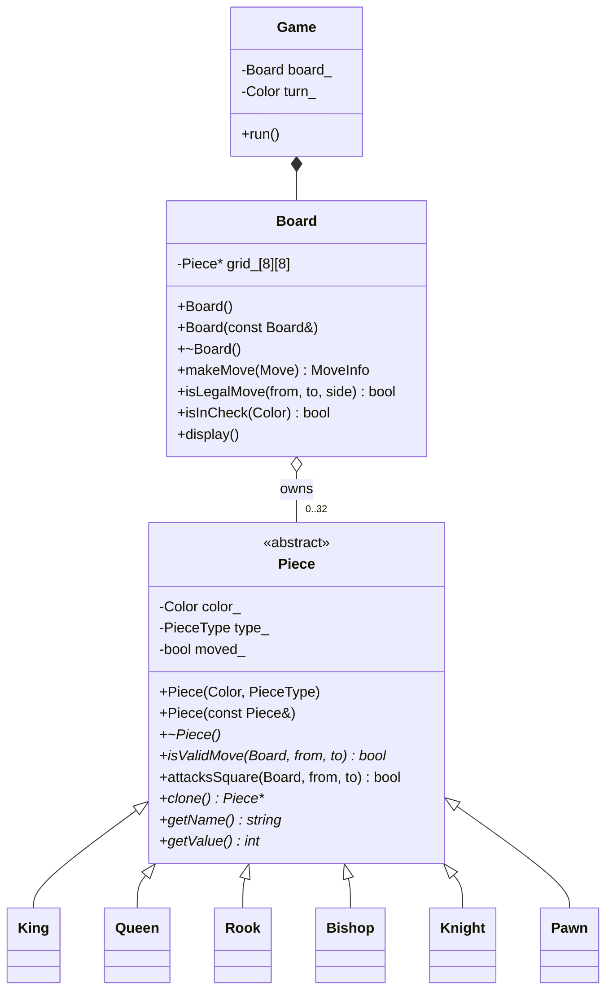

# ♟ C++ Chess Game


A complete **console chess game for two players**, written in C++17 as an
**Object-Oriented Programming** course project.  It follows every rule of
chess — including castling, en passant, promotion, check, checkmate, stalemate
and the draw rules — and is built to show the core OOP ideas clearly:
**classes & objects, constructors & destructors, inheritance, method
overriding, polymorphism, encapsulation and abstraction.**

```
      a  b  c  d  e  f  g  h
   8  r  n  b  q  k  b  n  r   8
   7  p  p  p  p  p  p  p  p   7
   6  .  .  .  .  .  .  .  .   6
   5  .  .  .  .  .  .  .  .   5
   4  .  .  .  .  .  .  .  .   4
   3  .  .  .  .  .  .  .  .   3
   2  P  P  P  P  P  P  P  P   2
   1  R  N  B  Q  K  B  N  R   1
      a  b  c  d  e  f  g  h
```

## Team

| Member | Responsibility |
|---|---|
| **Insia Fatima** | Inheritance & classes — `Piece` base class, `King`, `Queen`, `Rook`, `Bishop`, `Knight`, `Pawn`, constructors, destructors, attributes |
| **Rahmah Rizwan** | Polymorphism & move validation — `isValidMove()` / `attacksSquare()` overrides, castling, en passant, check detection, legal-move filtering |
| **Zainab Azram** | Board management & game logic — the 8×8 `Board`, display, turns, captures, promotion, undo, checkmate / stalemate / draw detection |

Every source file has `[Name]` comment banners that show exactly who wrote which part.

## Build and run

You only need a C++17 compiler (g++, clang or MinGW).

| Platform | Commands |
|---|---|
| Linux / macOS / MSYS2 | `make` then `./chess` |
| Windows (MinGW) | double-click `build.bat`, then run `chess.exe` |
| Any (CMake) | `cmake -S . -B build && cmake --build build` |
| By hand | `g++ -std=c++17 -Iinclude src/*.cpp -o chess` |

```
make run        # build and play
make demo       # guided tour of the OOP features
make test       # run the automatic tests (add --deep to ./test_chess for more)
```

### Options

| Option | Meaning |
|---|---|
| `--color` | coloured board (ANSI terminals, Windows 10+) |
| `--unicode` | pieces drawn as ♔ ♕ ♖ ♗ ♘ ♙ |
| `--fen "<fen>"` | start from any position in FEN notation |
| `--trace` | print constructor / destructor messages while playing |
| `--demo` | run the OOP demonstration and exit |

## How to play

Type a move as `e2 e4` (also `e2e4` or `e2-e4`).  Capital letters are White,
small letters are Black.

| Command | What it does |
|---|---|
| `moves e2` | highlight every legal move of the piece on e2 |
| `undo` | take back the last move |
| `history` | show the game so far in algebraic notation |
| `draw` / `resign` | offer a draw / give up |
| `help` / `quit` | help / leave |

Castling is `e1 g1` (king side) or `e1 c1` (queen side).  When a pawn reaches the
last rank you are asked what to promote to (or type `e7 e8 q`).

## Rules implemented

* All piece movements, captures and blocked paths
* **Check** warning, and you can never leave your own king in check (pins included)
* **Castling** (both sides, with all the "not through check" rules)
* **En passant** and **pawn promotion** (queen, rook, bishop or knight)
* **Checkmate**, **stalemate**
* Draws: insufficient material, threefold repetition, fifty-move rule, draw by agreement, resignation
* Undo, move history in standard algebraic notation (`Nf3`, `exd5`, `O-O`, `e8=Q#`)

## OOP concepts and where to find them

| Concept | Where |
|---|---|
| **Classes & objects** | `Piece`, `King` … `Pawn`, `Board`, `Game`, `Position`, `Move` |
| **Inheritance** | `King`, `Queen`, `Rook`, `Bishop`, `Knight`, `Pawn` all derive from `Piece` (`include/*.h`) |
| **Constructors** | `Piece(Color, PieceType)`, each piece's constructor calls the base one; `Board()`, `Game()` |
| **Copy constructor** | `Piece(const Piece&)` (used by `clone()`), `Board(const Board&)` (deep copy) |
| **Destructors** | `virtual ~Piece()`, derived destructors, `~Board()` frees all 32 pieces |
| **Rule of Three** | `Board` has a destructor, copy constructor and copy assignment |
| **Method overriding** | `isValidMove()`, `attacksSquare()`, `clone()`, `getName()`, `getValue()` |
| **Polymorphism** | the board holds `Piece*` and calls `piece->isValidMove(...)`; the right version runs for each piece |
| **Abstraction** | `Piece` is abstract (pure virtual functions) — it can't be instantiated |
| **Encapsulation** | private data (`color_`, `type_`, `moved_`, `grid_`) with getters / controlled setters |
| **Operator overloading** | `Position` supports `==`, `!=` and `<<` |
| **Static members** | `Piece::getLiveCount()` counts live objects (proves there are no leaks) |

See `make demo` — it prints the constructor/destructor order and the polymorphic
behaviour live.

### Class diagram



## Testing

`make test` runs 85+ automatic checks: lifecycle (no leaks), polymorphic moves,
checkmate, stalemate, castling, en passant, promotion, draws, FEN loading and
**perft** — counting every legal move sequence from five famous test positions
(for example 197,281 positions at depth 4 from the start).  Every number matches
the published reference values, which is strong evidence that the rules are
implemented correctly.  The code also runs clean under AddressSanitizer and
UBSan.

## Project layout

```
chess-game/
├── include/          class declarations (.h)
├── src/              class implementations (.cpp) + main.cpp
├── tests/            test_chess.cpp  (unit tests + perft)
├── docs/             project report (PDF) and GitHub guide
├── .github/workflows CI: builds and tests on every push
├── Makefile  CMakeLists.txt  build.bat
└── README.md  LICENSE  .gitignore
```

## License

MIT — see `LICENSE`.
